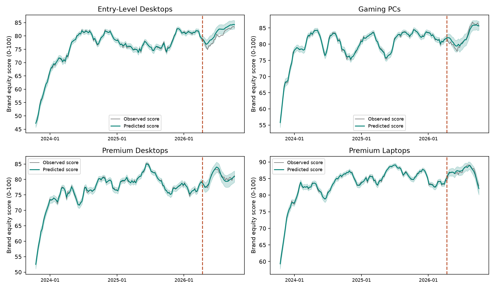
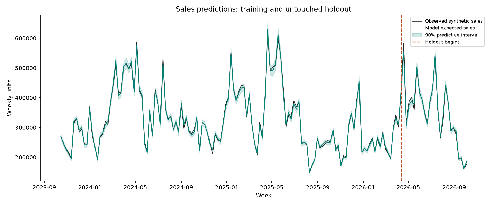
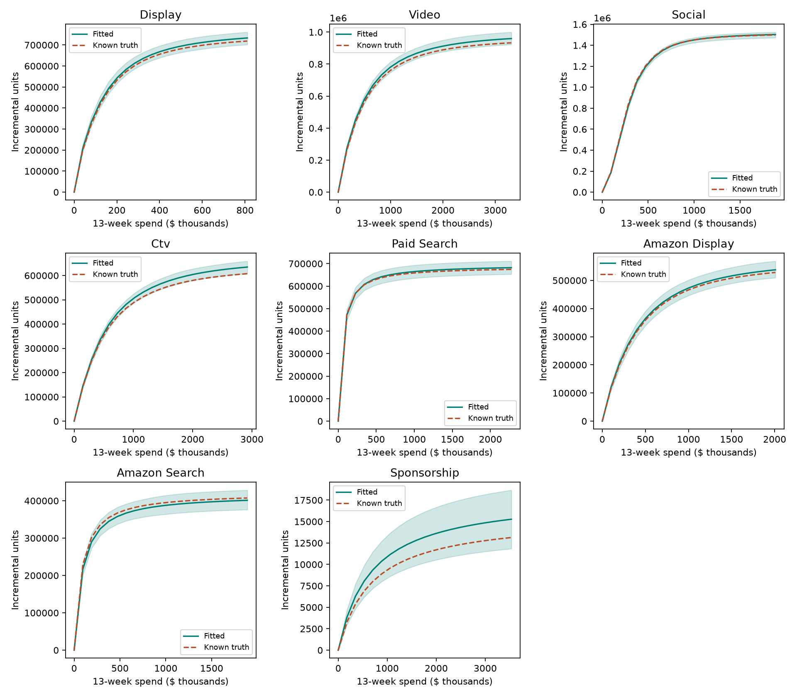
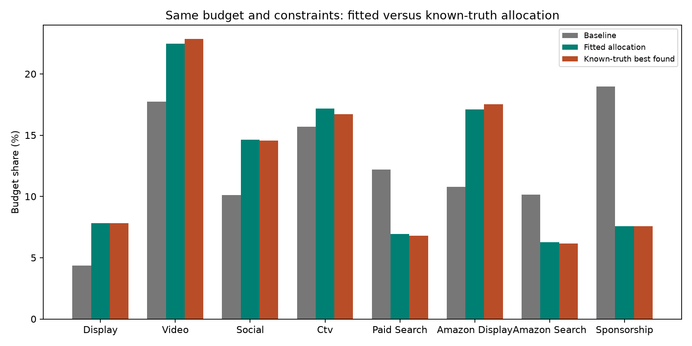

# Synthetic MMM Reference Run

Status: **PASS**. This is a controlled synthetic prototype, not a real-data causal certification.

## Workflow

1. Generate 156 weeks, four products, three tiers, and 7 media channels.
2. Fit the first 130 weeks with hierarchical product/tier intercepts,
   price, macro, base-price growth, promotion, post-promotion dip, PrimeDays, and annual seasonality.
3. Estimate channel coefficients and saturation. Display, Video, Social, CTV, and optional Amazon Display
    use independent adstock; paid-search and optional Amazon Search clicks have no adstock. Social has
    a fixed S-shaped Hill power of 2; other powers are 1.
4. Predict the final 26 weeks conditional on their supplied media and nonmedia inputs.
5. Compare estimated parameters and allocated contributions with the predeclared synthetic truth.
6. Allocate a 13-week budget using known CPM/CPC mappings, recent carryover, and identical fitted/truth constraints.

Stockout censoring enabled: True. Funnel mediation enabled: True.
No latent random-walk sales baseline or stochastic CPM/CPC likelihood is included.
When brand mode is enabled, logit brand scores use a linear-Gaussian Kalman filter with
process shocks and noisy score measurements; nonlinear sales are not fed back as Gaussian filter observations.
The generator and fitted model intentionally match. This makes a reference example understandable;
it does not establish robustness to model misspecification or endogenous real-world spend.

## Checks

- Sampling: R-hat 1.004822819703375, minimum bulk ESS 1468,
  minimum tail ESS 1538, divergences 0,
  maximum depth 10/12. Gate: True.
- Holdout log-sales RMSE 0.0566 versus product-tier mean benchmark
  0.5474; reduction 89.7%.
- Nominal 90% predictive coverage 92.9%. Forecast gate: True.
- Media truths in 90% parameter intervals: 7/7.
  Maximum media relative error 2.6%; maximum decay absolute error
  0.017. Recovery gate: True.
- Contribution accounting gate: True.
- Budget and known-truth unit-objective gate: True.

Gates were specified in code before fitting: R-hat below 1.01, bulk ESS at least 400,
tail ESS at least 200, no divergences or depth-cap hits; forecast beats benchmark with
coverage between 85% and 97%; at least four of 7 media truths covered, maximum
media coefficient error 25%, decay error 0.10; contribution error 25%; budget conserved
and fitted allocation within 2% of the best known-truth objective found under the same constraints.
One synthetic seed is a demonstration, not a calibration study across datasets.

## Interpretation

Media coefficients are maximum log-sales effects, not constant per-dollar returns.
Half-saturation is measured relative to each channel's reference exposure. Decay controls
carryover over at most 13 lag positions, including the current week.
The attribution table distributes total modeled media lift in proportion to each channel's
log lift. This accounting convention sums exactly to expected sales; individual channel-removal
effects would not generally sum because the sales model is multiplicative.
In stockout mode both baseline and media lift are evaluated as expected fulfilled sales
under the same inventory caps, not as unconstrained demand contributions.

Optimization holds one weekly share per channel constant for 13 weeks, keeps product proportions
fixed, and bounds shares to 40%-180% of their baseline values. Existing adstock is carried forward.
The original allocation maximizes expected fulfilled units when stockouts are enabled, otherwise
expected demand units. A separate expected-profit allocation and a risk-adjusted allocation are
also reported. Future prices, controls, and inventory are supplied planning assumptions.
Six local starts are used for both fitted and known-truth optimizers: the oracle is best found,
not a proof of the global optimum. Uncertainty bands on response curves describe expected lift,
whereas sales forecast bands include observation noise.

All posterior parameter draws are preserved in posterior_draws.npz. Derived forecasts and
attribution use up to 512 draws; unit allocation uses up to 128 posterior draws, and financial
allocations use 512 predictive scenarios with common random numbers across candidate budgets.
Truth columns are used for evaluation only, not as fitted predictors or parameter prior centers.
No generating parameters were tuned against this run's results. Stockout mode reuses the baseline
dates and latent demand for a paired extension; its holdout is a controlled comparison, not a new
independent temporal validation after viewing the baseline.

## Profit And Risk Optimization

The synthetic profit proxy is fulfilled units times list price after discount times an assumed
product-tier contribution margin, minus media and sponsorship spend. Assumed margins are not
observed costs and should be replaced with validated contribution economics before business use:

- Entry-Level Desktops: 18%, 20%, 16%
- Gaming PCs: 22%, 28%, 19%
- Premium Desktops: 25%, 30%, 22%
- Premium Laptops: 20%, 26%, 18%

Expected-profit allocation maximizes posterior expected net contribution. Risk-adjusted allocation
maximizes 50% expected net profit plus 50% lower-tail CVaR at the 5% level, across 512 predictive
scenarios. Scenarios include posterior parameter draws, log-Normal demand residuals, inventory caps,
and brand process shocks when enabled. Fixed total spend is held constant; future prices, controls,
and inventory are supplied. Taxes, returns, fulfillment/fixed costs, uncertain media prices, and
value beyond the 13-week horizon are excluded. This is a synthetic decision demonstration, not
validated business profit or a global-optimum guarantee.

When Amazon is enabled, its planned Search allocation is a spend cap/activity input. Scenario CPC
charges are expected paid clicks times the synthetic $2 CPC; unspent cap remains unspent. The profit
allocation CSV reports planned budget and expected charged spend separately.

- Expected net profit: baseline $1,859,834,480; optimized $1,890,996,666.
- 5% predictive profit CVaR: baseline $1,846,222,552;
    risk-adjusted allocation $1,884,113,971.
- Risk weight on CVaR: 50%; total-budget error: $0.000000.

## Stockout Extension

The underlying realized demand and predictors are identical to the uncapped funnel run at the same seed.
Inventory uses an independent random stream and conditional demand quantiles with product/tier
variation and temporary supply reductions. It is not constructed from realized demand shocks.
Observed sales equal min(latent demand, inventory). The fit uses a right-censored Normal likelihood
in log units: a capped observation contributes a survival probability, not a density at the cap.
Inventory and stockout flags do not enter the demand predictor. Synthetic latent demand is evaluation
truth only. No separate classifier or supply-forecast model is fitted; event probability is implied
by the fitted demand distribution and supplied cap.

- Training stockouts: 12.2%; holdout: 14.4%.
- Holdout latent-demand log RMSE: 0.0636.
- Latent-demand 90% coverage: 88.1%.
- Predicted holdout stockout rate: 15.9%.
- Stockout Brier score: 0.1175; constant training-rate benchmark:
    0.1239.

Fulfilled-sales means and scenario objectives use the analytic expectation E[min(D, cap)] for
log-Normal demand, not min(E[D], cap). Predictive draws are capped, while latent intervals are not.
Latent-demand coverage is evaluated unconditionally across all held-out demand realizations;
conditioning on realized stockouts selects an upper tail and does not imply nominal subgroup coverage.
The forecast gate additionally requires latent log RMSE below 0.10 and latent coverage 85%-97%.
Event probabilities are descriptive calibration checks, not an additional pass gate at this stage.

The optimizer holds provided inventory fixed while changing media, so spending can lose marginal
value at capacity. It does not optimize replenishment or carry unused inventory between weeks.
Caps were generated using synthetic expected demand, but only numerical caps are given to planning;
the cap-generating truth is not used as a demand predictor. Future caps must be supplied in real use.

## Funnel Extension

CTV saturation changes latent branded-search intensity together with macro, seasonality,
and an observed exogenous organic-demand index. Observed search volume is rounded log-Normal.
Paid clicks are Binomial conditional on observed search counts, with capture probability
max_rate * paid_activity / (paid_activity + budget_half). Zero spend implies zero paid clicks.
Likelihoods are fitted once per product-week, never repeated across price tiers. Mediator
likelihoods exclude the entire holdout, just like the sales likelihood.

Sales use latent search intensity times capture probability, not observed holdout searches
or clicks. Independent exogenous variation in CTV, organic demand, and paid-search spend
is deliberately included to identify this matched synthetic example. There is no separate
organic-search sales coefficient, and paid clicks still have no adstock. Display, Video,
Social, and CTV retain their own adstock and saturation.

- Search holdout log RMSE: 0.0787; 90% coverage:
    91.3%.
- Click holdout log RMSE: 0.0707; 90% coverage:
    95.2%.
- CTV mediated log-lift relative recovery error: 1.6%.
- Funnel gate: True.

Attribution assigns CTV its direct log lift plus the additional click-related log lift
caused by CTV. Paid search receives the remaining click-related log lift with CTV removed.
This is an explicitly chosen ordered mediation accounting convention; other interaction
allocation conventions are possible. The components sum exactly without counting the
same mediated pathway twice. Counterfactual response curves and optimization recompute
search intensity and clicks when CTV or paid-search spending changes.

Paid-search reference spend is nominal reference clicks times $1.50; it is a bid/capture
activity index, not a promise that actual clicks always cost $1.50. Because search opportunity
changes, effective realized CPC varies. Search intensity exp(log_mean) is a structural latent
driver; expected observed search counts additionally include log-Normal measurement noise.
The sales equation uses the structural driver, not the noisy realized count.

Funnel gates were set before this fit: mediator holdout log RMSE below 0.20; search coverage
85%-97%, click coverage 85%-99% (zero-spend rows have deterministic zero clicks); mediated
log-lift error below 25%; search CTV effect and both click-capture parameter errors below 20%.
Stockout censoring in this run: True. Sales likelihoods and planning use inventory caps after funnel-driven demand.

## Amazon Sponsored Channels

Amazon Display is generated as impression exposure and priced at a synthetic $14 CPM. Amazon Search
generates on-platform query opportunities from exogenous organic demand and controls; paid clicks are
Binomial with spend-dependent capture. The sales model uses expected clicks as a saturated media
feature, not observed holdout clicks. Amazon Search has a synthetic $2 CPC: realized synthetic spend
equals paid clicks times CPC, so zero clicks produce zero click charges. The budget-activity input is
kept separately from realized CPC spend. These assumptions are illustrative and are not Amazon billing
or attribution data.

- Amazon Search opportunity holdout log RMSE: 0.0832;
    90% coverage: 91.3%.
- Amazon paid-click holdout log RMSE: 0.0800;
    90% coverage: 93.3%.
- CPC spend reconciliation error: $0.00000000.
- Amazon mediator gate: True.

Amazon Search and Display are separate channels from generic Display and Paid Search. Marketplace
search intent, sponsored placement rules, click capture, and platform attribution are not assumed to
match Google or other networks. This extension has a matched synthetic generator/model by design; its
recovery gates do not establish real-world incrementality.

## Hierarchical Media Shrinkage

Each channel has a positive population response and product-specific positive responses.
For product p and channel c, beta[p,c] = population_beta[c] * exp(deviation[p,c]).
Deviations are zero-sum on the log scale, so the population coefficient is the geometric
center of the four product coefficients. A noncentered orthonormal contrast parameterization
uses standard-Normal contrast values and one learned HalfNormal(0.3) scale per channel.
Smaller scales pool product responses more tightly; larger supported scales permit more
heterogeneity. This adds hierarchical shrinkage of media coefficients, not just intercepts.

Product media truths covered by 90% intervals: 28/28.
Maximum product media coefficient relative error: 4.8%.
The product-recovery gate uses the same 25% maximum coefficient error tolerance and at least
80% truth inclusion, now evaluated over 28 product-by-channel coefficients. The planted
product deviations were declared before fitting; priors are not centered on those truths.

Attribution, CTV-mediated lift, response curves, and allocation all use product coefficients.
Adstock, half-saturation, nonmedia controls, and mediator parameters remain shared.
Price tiers within a product share its media coefficient. Four groups limit precision of
the learned hierarchy scales. Recovery and the prior structure demonstrate the implementation;
they do not prove shrinkage improves out-of-sample performance over a no-pooling alternative.
No no-pooling comparison or weak-product-data stress test has been run yet.
See product_media_recovery.csv and media_hierarchy_scales.csv for estimates and intervals.

## Persistent Brand Equity And Baseline Sales

Brand equity is a measured 0-100 score and a persistent latent logit state, not a separate
outcome disconnected from sales. Each product has one weekly score measurement shared across
its tiers. A logistic-normal measurement likelihood is jointly fitted with sales and mediators.
The state blends its prior state with a target driven by 7 media response features,
current sponsorship impressions, and distribution coverage. Measurement noise and Gaussian
process innovations are estimated; the latent state is stochastic.

Sponsorship is an impression measure with a separate spend column at a known synthetic $18 CPM.
It affects baseline sales through brand equity, not a new immediate-sales coefficient. Volume-
weighted distribution is 100 * covered-store sales-volume weights / all available-store weights,
per product and week. It measures where the product is currently assorted; it is not an
unweighted store count and there is no separate assortment-breadth variable or direct physical
distribution sales term in this initial design. Coverage is supplied, not optimized or forecast.

Previous-week latent brand score changes log baseline sales relative to a score of 50, per
10 score points. All posterior uncertainty in media transforms and brand parameters is propagated
jointly. Observed held-out brand scores are never sales inputs. Brand baseline contribution is
exported separately from immediate/funnel media attribution. Long-run lift is not double-counted
in the short-run media allocation table, nor attributed retrospectively to particular historic
funding channels. Such an allocation requires a separately agreed counterfactual convention.

- Brand holdout RMSE: 0.959 score points versus last-known-score
    benchmark 2.608.
- Nominal 90% score coverage: 88.5%.
- Estimated weekly persistence: 0.901.
- Estimated baseline log-sales effect per 10 prior-week score points:
    0.079.
- Maximum brand-response relative recovery error: 15.3%.
- Brand gate: True.

Brand gates were set before fitting: beat the last-known-score benchmark, 85%-97% coverage,
maximum driver/sales/persistence relative coefficient error 25%, persistence absolute error 0.10.
The distribution and sponsorship schedules are independently varied in the synthetic design;
real-data feedback/endogeneity and brand measurement construct validity are not established.

The optimizer now has six spend lines including sponsorship. It carries the historical brand
state into 13 future weeks and updates it under each proposed media/sponsorship plan, then
optimizes fulfilled units subject to fixed inventory. Distribution remains a supplied operational
scenario without an invented cost model. The objective remains units, not equity points or profit;
benefits beyond the 13-week horizon are not valued. Brand response coefficients are shared across
products; sales media coefficients retain the selected product hierarchy.

## Budget Result

- Fixed 13-week budget: $9,312,660.
- Model-predicted lift over baseline allocation: 1.9%.
- Known-truth units at baseline: 5,529,446.
- Known-truth units at fitted allocation: 5,624,543.
- Known-truth best found: 5,624,567.
- Known-truth objective shortfall: 0.00%.

